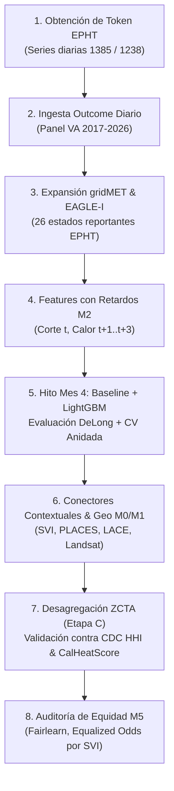

# AGENTS.md — Trayectoria, Arquitectura y Hoja de Ruta del Gemelo Digital

> **Proyecto:** *A Fairness-Aware Explainable Digital Twin for Compound Heat–Blackout Health Risk in U.S. Urban Communities* (`xai-dt-heat`)  
> **Referencia maestra:** [`plan_gemelo_digital_calor.md`](file:///home/lenzhit/unt/proyecto-investigacion/Gemelo-de-calor/plan_gemelo_digital_calor.md) y [`README.md`](file:///home/lenzhit/unt/proyecto-investigacion/Gemelo-de-calor/README.md)  
> **Última actualización:** 2026-09-29  
> **Objetivo de este archivo:** Servir como bitácora viva para desarrolladores y agentes de IA (Antigravity/Gemini), registrando el contexto del sistema, lo implementado, las decisiones técnicas clave, las restricciones de datos y los siguientes pasos en la investigación.

---

## 1. Resumen Ejecutivo del Proyecto

El proyecto implementa un **Gemelo Digital (Digital Twin) explicable y con enfoque de equidad algorítmica** para modelar el riesgo de morbilidad por calor extremo en eventos compuestos (olas de calor concurrentes con apagones eléctricos).

### Problema y Brechas Clave
1. **Eventos Compuestos Dinámicos:** Los sistemas operativos actuales (CDC Heat & Health Index, CalHeatScore) son estáticos o ignoran la infraestructura eléctrica. Un apagón elimina el principal factor protector urbano: el aire acondicionado.
2. **Restricción Real de Datos (CDC EPHT):** No existen datos públicos nacionales de desenlace diario a nivel sub-estatal. La solución metodológica es un **diseño de fusión en dos escalas**:
   - **Escala Temporal (Etapa A):** Panel estado-día (serie diaria de urgencias por HRI en población VA - medida 1385 / región HHS - medida 1238) para aprender la función exposición-respuesta, retardos, no linealidades e interacción con cortes de luz.
   - **Escala Espacial (Etapa B):** Panel transversal por condados (medida 440 anual y 1034 quinquenal de mortalidad) con SVI, PLACES, LACE, Landsat para estimar modificadores de susceptibilidad.
   - **Desagregación y Validación Externa (Etapa C):** Superficie de riesgo ZCTA contrastada contra CDC HHI (1504) y CalHeatScore.
3. **Gemelo Genuino (L0–L5):** No es un modelo offline estático; incluye registro de linaje de predicciones (L0), almacén de estado bitemporal (L1), conectores de sincronización (L2), escalera de modelos con XAI (L3), motor contrafactual componible (L4) y calibración retrospectiva frente a revisiones de datos (L5).

---

## 2. Estado Actual de la Arquitectura (Capas L0–L5)

| Capa | Módulo | Estado | Descripción y Componentes |
|---|---|:---:|---|
| **L0: Trazabilidad** | [`src/xdt/twin/registry.py`](file:///home/lenzhit/unt/proyecto-investigacion/Gemelo-de-calor/src/xdt/twin/registry.py) | ✅ Completo | Registro inmutable de predicciones, modelos desplegados, atribuciones SHAP y observaciones censuradas. |
| **L1: Estado Bitemporal** | [`src/xdt/twin/state.py`](file:///home/lenzhit/unt/proyecto-investigacion/Gemelo-de-calor/src/xdt/twin/state.py) | ✅ Completo | Almacén bitemporal (`valid_date`, `known_at`) con capacidad de viaje en el tiempo y auditoría de revisiones. |
| **L2: Sincronización** | [`src/xdt/ingest/`](file:///home/lenzhit/unt/proyecto-investigacion/Gemelo-de-calor/src/xdt/ingest/) | 🟡 En progreso (3/8) | • **EPHT** (`epht.py`): Medida 440 + descubrimiento de metadatos (1385/1238 pendiente de token).<br>• **gridMET** (`gridmet.py`): OPeNDAP ASCII con desempaquetado de offsets y agregación poblacional.<br>• **EAGLE-I** (`eaglei.py`): Series 15-min de clientes sin luz normalizadas a días locales.<br>• *Pendientes:* SVI, PLACES, LACE, Landsat, NWS. |
| **L3: Emulador & XAI** | [`src/xdt/models/`](file:///home/lenzhit/unt/proyecto-investigacion/Gemelo-de-calor/src/xdt/models/)<br>[`src/xdt/explain/`](file:///home/lenzhit/unt/proyecto-investigacion/Gemelo-de-calor/src/xdt/explain/)<br>[`src/xdt/report/`](file:///home/lenzhit/unt/proyecto-investigacion/Gemelo-de-calor/src/xdt/report/) | 🟡 Funcional | • Escalera de 4 modelos (Umbral $\to$ Regresión Logística $\to$ Random Forest $\to$ LightGBM).<br>• Validación cruzada anidada y pruebas estadísticas robustas (DeLong, bootstrap por bloques, Diebold-Mariano).<br>• Explicabilidad local con SHAP.<br>• Generador de reporte CRISP-DM interactivo (`xdt crisp`). |
| **L4: Escenarios** | [`src/xdt/twin/scenarios.py`](file:///home/lenzhit/unt/proyecto-investigacion/Gemelo-de-calor/src/xdt/twin/scenarios.py) | 🟡 Funcional | Operadores componibles inmutables (`ola_de_calor | apagon`) con trazabilidad de linaje contrafactual. |
| **L5: Calibración** | [`src/xdt/twin/calibrate.py`](file:///home/lenzhit/unt/proyecto-investigacion/Gemelo-de-calor/src/xdt/twin/calibrate.py) | ✅ Completo | Calibración retrospectiva con emparejamiento bitemporal honesto, manejo de censura y cálculo de deriva. |
| **Agent / Copilot** | [`src/xdt/agent/`](file:///home/lenzhit/unt/proyecto-investigacion/Gemelo-de-calor/src/xdt/agent/) | ✅ Completo | • **LangGraph**: Copiloto de simulación con 4 nodos (`parse` $\to$ `simulate` $\to$ `explain` $\to$ `synthesize`).<br>• **LangFlow**: Flujo RAG documental exportable (`langflow/gemelo_rag_flow.json`). |
| **M0/M2: Features & Armonización** | [`src/xdt/features/`](file:///home/lenzhit/unt/proyecto-investigacion/Gemelo-de-calor/src/xdt/features/)<br>[`src/xdt/harmonize/`](file:///home/lenzhit/unt/proyecto-investigacion/Gemelo-de-calor/src/xdt/harmonize/) | 🟡 Funcional | • Índice de calor NWS, percentil 95 local sin fuga temporal, rachas, eventos compuestos.<br>• Centroides ponderados por población y agregación estatal.<br>• *Pendiente:* Promedio areal ZCTA/tract con geopandas/rioxarray. |
| **Frontend / Consola** | [`app/consola.html`](file:///home/lenzhit/unt/proyecto-investigacion/Gemelo-de-calor/app/consola.html)<br>[`src/xdt/export.py`](file:///home/lenzhit/unt/proyecto-investigacion/Gemelo-de-calor/src/xdt/export.py) | ✅ Funcional | Consola interactiva autocontenida que lee el estado L1, el registro L0 y el modelo desplegado. |

---

## 3. Trayectoria de lo Realizado (Registro Histórico)

### Hitos Implementados
- [x] **Definición metodológica v2.0:** Plan de investigación completo basado en auditoría empírica de APIs públicas ([`plan_gemelo_digital_calor.md`](file:///home/lenzhit/unt/proyecto-investigacion/Gemelo-de-calor/plan_gemelo_digital_calor.md)).
- [x] **Capa L1 (Estado bitemporal):** Soporte en DuckDB/Parquet de dos ejes temporales (`valid_date` y `known_at`) para evitar fuga retrospectiva de información y permitir snapshots históricos exactos.
- [x] **Capa L0 (Registry):** Registro criptográfico/hasheado de predicciones, escenarios y metadatos de modelos.
- [x] **Conectores de Ingesta L2:**
  - `epht.py`: Cliente robusto contra errores camuflados (detecta 429 dentro de HTTP 200) y comando `xdt ingest discover`.
  - `gridmet.py`: Extracción OPeNDAP rápida (~0.8s/celda-año), desempaquetado de escala/offset por variable (`tmmx` vs `tmmn`), manejo de valores nulos oceánicos.
  - `eaglei.py`: Procesamiento de streaming de grandes volúmenes (~1.2GB/año), corrección de FIPS sin cero inicial, agregación de marcas de tiempo UTC a día civil local y estimación de cobertura.
- [x] **Pipeline CRISP-DM y Modelos L3:**
  - `panel.py`: Construcción del panel estado-día.
  - `ladder.py` / `train.py`: Entrenamiento de la escalera de modelos con CV anidada.
  - `stats.py`: Suite de tests estadísticos robustos (DeLong + Holm, Nadeau-Bengio, Spiegelhalter, Diebold-Mariano HAC).
  - `deploy.py`: Empaquetado del modelo ganador en `data/models/` y registro de predicciones en L0.
  - `crisp.py` / `html.py`: Generación de reporte HTML navegable y explicativo.
- [x] **Capa L4 & L5:**
  - Escenarios componibles mediante sobrecarga de operadores (`|`) con preservación de linaje.
  - Módulo de calibración retrospectiva (`calibrate.py`) con soporte de censura de datos e intervalos.
- [x] **Capa de Agentes Inteligentes (LangGraph & LangFlow):**
  - **LangGraph Copilot:** Orquestación de grafos con estado (`AgentCopilotState`) que interpreta peticiones en lenguaje natural, ejecuta simulaciones de escenarios compuestos L4 sobre el estado L1, extrae atribuciones XAI y formatea respuestas epidemiológicas con salvaguarda causal. Comandos `xdt agent copilot` y `xdt agent chat`.
  - **LangFlow RAG Assistant:** Grafo RAG exportable (`langflow/gemelo_rag_flow.json`) con `RecursiveCharacterTextSplitter`, embeddings y `PromptTemplate`. Base de conocimiento expandida (16 tópicos con etiquetado semántico y citas metodológicas) y motor de búsqueda con scoring por relevancia (tokens, bigramas y tags) en la consola interactiva. Comando `xdt agent export-flow`.
- [x] **Consola Web y Exportación:**
  - `export.py` inyecta dinámicamente datos del gemelo en [`app/consola.html`](file:///home/lenzhit/unt/proyecto-investigacion/Gemelo-de-calor/app/consola.html).
- [x] **Infraestructura y Testing:**
  - 134 tests unitarios pasando (`uv run pytest`), con tests de contrato (`-m contract`) separados para APIs externas.

---

## 4. Hoja de Ruta y Próximos Pasos (Backlog Priorizado)



### Detalle de Tareas Pendientes

### Fase Inmediata (Bloqueante)
1. **Gestión del Token EPHT (CDC):**
   - Solicitar/configurar `XDT_EPHT_TOKEN` en `.env`.
   - Ingestar la serie diaria estatal de HRI en población VA (medida 1385, 2017–2026) y serie regional HHS (medida 1238).
2. **Ampliación de Cobertura Geográfica de Exposición:**
   - Descargar gridMET y EAGLE-I para los 26 estados que reportan a EPHT (2017–2025/2026) mediante descargas concurrentes/por lotes.

### Fase de Modelado y Features (M2, L3, M4)
3. **Ingeniería de Variables con Retardos y Sensibilidad:**
   - Incorporar retardos distribuidos en eventos compuestos (p. ej. apagón en $t$, ola de calor en $t+1 \dots t+3$).
   - Barrido de sensibilidad de umbrales de apagón (fracción de clientes afectados vs. horas de corte acumuladas).
4. **Entrenamiento y Selección Multi-año:**
   - Ejecutar `xdt crisp` sobre la serie temporal multianual completa una vez disponible el desenlace 1385.
   - Contrastar formalmente las hipótesis **H1** (superioridad sobre umbral meteorológico) y **H2** (interacción supra-aditiva calor-apagón con RERI).

### Fase de Desagregación y Equidad (Etapas B y C, M0, M5)
5. **Conectores Espaciales Estáticos:**
   - Ingesta de CDC SVI 2022 (vulnerabilidad social por ZCTA/tract).
   - Ingesta de CDC PLACES 2025 (comorbilidades crónicas y necesidades sociales).
   - Ingesta de Census LACE 2023 / Romitti et al. (prevalencia de aire acondicionado).
   - Ingesta de Landsat C2 L2 (temperatura superficial e islas de calor urbanas).
6. **Módulo de Fusión Espacial y Validación Cruzada Externa:**
   - Implementar `harmonize/crosswalk.py` (ZCTA $\leftrightarrow$ tract $\leftrightarrow$ condado).
   - Evaluar **H5**: Correlación de Spearman contra CDC Heat & Health Index (medida 1504).
   - Evaluar **H6**: Divergencia en días con apagón frente a CalHeatScore.
7. **Auditoría de Equidad Algorítmica (M5):**
   - Implementar [`src/xdt/fairness/`](file:///home/lenzhit/unt/proyecto-investigacion/Gemelo-de-calor/src/xdt/fairness/) con Fairlearn y bootstrap sobre quintiles de SVI (**H3**).

---

## 5. Guía de Desarrollo para Agentes y Convenciones Técnicas

### Requisitos y Entorno
- **Python:** Fijado estrictamente en **3.12** (compatibilidad de wheels con PyTorch/LightGBM).
- **Gestor de paquetes:** `uv`.
- **Ejecución de tests:**
  ```bash
  uv sync --extra ml --extra geo --extra fair
  uv run pytest
  ```
- **Tests de contrato (APIs externas):**
  ```bash
  uv run pytest -m contract
  ```

### Reglas Inviolables del Sistema
1. **Bitemporalidad Estricta:**
   - `known_at` SIEMPRE debe ser naive UTC. Usar `xdt.twin.state.now_utc()`, NUNCA `datetime.now()`.
   - Prohibido antedatar revisiones o crear hechos con fechas de validez en el futuro.
2. **Inmutabilidad de Datos Crudos:**
   - `data/raw/` es de solo lectura y está bajo control de DVC. Las ingestas son idempotentes.
3. **No Afirmación de Causalidad:**
   - Los escenarios contrafactuales son contrafactuales *del modelo*, no certezas causales del mundo. Los textos de los reportes deben mantener rigor epidemiológico y evitar sobreinterpretaciones.
4. **Validación de Respuestas HTTP:**
   - Toda llamada a EPHT debe validar el cuerpo del JSON para atrapar errores 429 encapsulados en códigos HTTP 200 antes de persistir en caché.

---

## 6. Referencias a Archivos Clave del Código

- **Plan Maestro de Investigación:** [`plan_gemelo_digital_calor.md`](file:///home/lenzhit/unt/proyecto-investigacion/Gemelo-de-calor/plan_gemelo_digital_calor.md)
- **Documentación General de Uso:** [`README.md`](file:///home/lenzhit/unt/proyecto-investigacion/Gemelo-de-calor/README.md)
- **CLI Principal:** [`src/xdt/cli.py`](file:///home/lenzhit/unt/proyecto-investigacion/Gemelo-de-calor/src/xdt/cli.py)
- **Motor de Estado L1:** [`src/xdt/twin/state.py`](file:///home/lenzhit/unt/proyecto-investigacion/Gemelo-de-calor/src/xdt/twin/state.py)
- **Motor de Calibración L5:** [`src/xdt/twin/calibrate.py`](file:///home/lenzhit/unt/proyecto-investigacion/Gemelo-de-calor/src/xdt/twin/calibrate.py)
- **Motor de Escenarios L4:** [`src/xdt/twin/scenarios.py`](file:///home/lenzhit/unt/proyecto-investigacion/Gemelo-de-calor/src/xdt/twin/scenarios.py)
- **Tests Estadísticos Robustos:** [`src/xdt/validate/stats.py`](file:///home/lenzhit/unt/proyecto-investigacion/Gemelo-de-calor/src/xdt/validate/stats.py)
- **Consola Web:** [`app/consola.html`](file:///home/lenzhit/unt/proyecto-investigacion/Gemelo-de-calor/app/consola.html)
